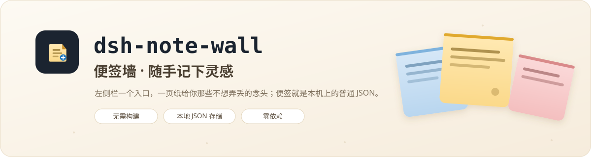
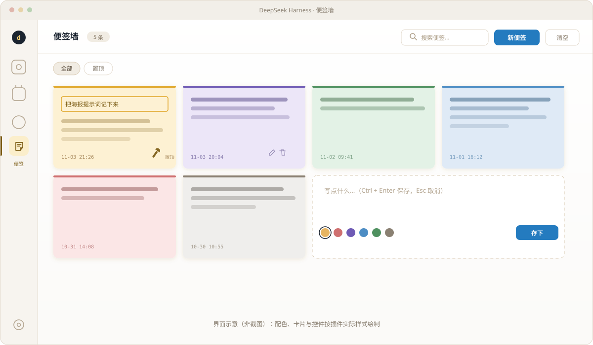
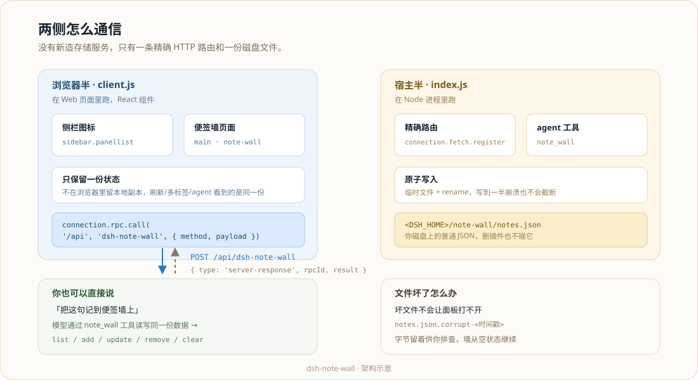

<div align="center">



# dsh-note-wall

**A sticky-note wall for the DeepSeek Harness web GUI: one icon in the left rail,
one page for the ideas you do not want to lose.**

Notes are plain JSON on your own disk. No account, no sync, no network.

[](https://github.com/deepseek-ai/deepseek-harness)
[](LICENSE)
[](#)
[](#)

[简体中文](README.md) · **[English](README.en.md)**

</div>

---



## What it does

- **A sidebar entry.** A note icon sits in the left rail next to the built-in panels. Click it and the
  main column switches to the wall.
- **A wall of notes.** Cards lay out in a responsive grid. Each note carries its own colour, timestamp
  and controls.
- **Write one fast.** Press *New note*, type, then `Ctrl + Enter` to save (or `Esc` to cancel).
- **Keep the wall usable.** Pin, recolour (6 colours), edit, delete, search, filter to pinned only,
  and clear the whole wall behind a two-step confirmation.
- **An agent tool.** The Host half also registers a `note_wall` tool, so you can ask the model to read
  or write the wall directly ("jot this down as a note").

## Install

The plugin is a plain bundle — two JavaScript files, **no build step**, **no dependencies**.

```powershell
# via the plugin manager
#   action: install_bundle
#   target: <absolute path to this directory>
```

Then **restart DSH once**. The browser half activates immediately through HMR, but the Host half
(route + tool) is a Node module, and a running process keeps the copy it already loaded.

After that:

| Changed | To see it |
|---|---|
| `client.js` | Reload the page |
| `index.js` (route, tool, storage) | Restart DSH |

### Requirements

- DeepSeek Harness with the Web GUI (`@deepseek-ai/dsh-web-app`).
- The `connection` and `tools` Host services — both ship with the default `dsh-base` / `dsh-web-app`
  composition.

## Where notes live

```
<DSH_HOME>/note-wall/notes.json
```

- A single JSON document, written **atomically** (temp file + `rename`), so a crash mid-write cannot
  truncate the wall.
- A corrupt file does not brick the panel: the bytes are moved aside to
  `notes.json.corrupt-<timestamp>` and the wall starts empty instead of throwing on every open.
- Bounded at 2000 notes, 10000 characters each.
- **Deleting or upgrading the plugin never touches your notes.** Remove the plugin and the file stays.

## How the two halves talk



No new storage service, no session-event hacking. The browser half calls the Host half over the
harness's own connection dialect — the same one `dsh-context` and `dsh-opencode-palette` use:

```js
connection.rpc.call('/api', 'dsh-note-wall', { method, payload })
```

The Host half catches it with one exact route:

```js
connection.fetch.register({
  path: '/api/dsh-note-wall',
  methods: ['POST'],
  requestBody: 'buffered',
  fetch: routeFetch,
})
```

and answers `{ type: 'server-response', rpcId, result }`.

There is exactly one source of truth. The browser keeps no local copy, so a refresh, a second tab, and
the agent all see the same notes.

## Files

| File | What it is |
|---|---|
| `index.js` | Host half: the exact route, the `note_wall` tool, atomic persistence |
| `client.js` | Browser half: the rail icon and the wall page |
| `cordis.patch.yml` | Bundle patch — inserts the plugin row |
| `package.json` | Manifest, including the `dsh.client` declaration |
| `locale/en.json`, `locale/zh.json` | Display title and description for the plugin manager |
| `icon.svg` | Original icon |
| `docs/*.svg` | The artwork used in this README (all original vector) |

### Styling

The stylesheet uses only `--dsw-alias-*` theme tokens. Card tints are `color-mix` over an accent token
on top of `bg-layer-1`, so light and dark themes both work without a second palette. Every class name
is prefixed `nw-`, and the layout follows the harness's own management pages (a full-height scrolling
root, layer-1 cards, 13px body).

## What has been verified

- **Host half.** 23 assertions across three Host shapes: a normal one, one where the injected-service
  probe races to `undefined`, and one with no Fetch carrier at all. Covers route registration, tool
  registration, create/update/pin/recolour/delete/clear, pin-only updates keeping the body, oversized
  input clamping, unknown-method rejection, on-disk persistence, corrupt-file recovery, and teardown.
- **Browser half.** The bundle was evaluated against the shell's module-loader contract and rendered
  through `react-dom/server`: both slots register, the icon is a real `<svg>`, cards render with their
  tints, and every class used in the markup exists in the stylesheet.
- **Live.** The route answered and wrote a real note to disk; both slots (`sidebar.panellist` and
  `main`) show this plugin as an active occupant.

> **About the screenshot above:** it is an original vector mock-up drawn to the plugin's real colours
> and controls, not a browser screenshot. There is no fabricated screenshot in this repository.

## Uninstall

Remove the bundle through the plugin manager, then restart. Your notes stay at
`<DSH_HOME>/note-wall/`; delete that directory yourself to remove them.

## License

MIT — see [LICENSE](LICENSE).

<div align="center">

[](https://github.com/deepseek-ai/deepseek-harness)

</div>
